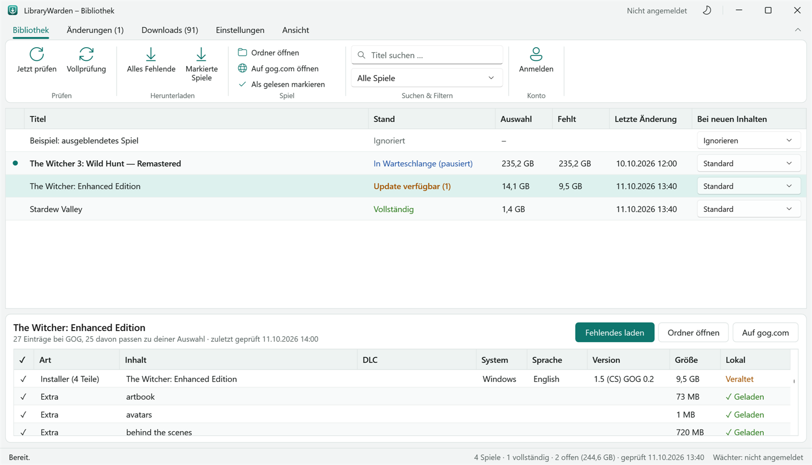

# LibraryWarden

Windows-Tool, das die eigene **GOG.com-Spielebibliothek** (Offline-Installer, Patches, Sprachpakete, Extras, DLCs)
herunterlädt und als Tray-App im Hintergrund meldet, wenn neue Inhalte bereitstehen.

> **Inoffizielles Projekt.** LibraryWarden steht in keiner Verbindung zu GOG sp. z o.o. oder CD PROJEKT S.A. und wird
> von ihnen weder unterstützt noch geprüft. „GOG“, „GOG.com“ und „GOG GALAXY“ sind Marken der jeweiligen Inhaber und
> werden hier nur beschreibend verwendet. Das Tool lädt ausschließlich Inhalte, die im eigenen Konto gekauft wurden.



## Funktionen

- **Anmeldung** über die offizielle GOG-Anmeldeseite (auch Zwei-Faktor sowie Google, Steam, Discord, Xbox).
  Gespeichert wird nur ein Anmelde-Token, verschlüsselt mit Windows-DPAPI – nie das Passwort.
- **Download** der gesamten Bibliothek oder einzelner Spiele: mehrteilige Installer, fortsetzbare Downloads (HTTP-Range),
  MD5-Prüfung, parallele Downloads, Bandbreitenbremse, alte Versionen ins Archiv verschieben/löschen/behalten.
- **Zwischenspeicher für externe Festplatten** (optional): Downloads landen zuerst in einem schnellen Ordner (z. B. auf der
  internen SSD, Größe frei einstellbar) und werden dort geprüft; ein Kopierer im Hintergrund schreibt sie danach
  nacheinander und am Stück auf das Bibliothekslaufwerk. Ist die Festplatte nicht angeschlossen, bleiben die Dateien
  im Zwischenspeicher und werden später übertragen – auch über einen Neustart hinweg.
- **Wächter**: regelmäßige Schnell- und Vollprüfung; meldet neue Spiele und DLCs, Installer-Updates (Version alt → neu),
  neue oder geänderte Extras – gefiltert nach eigener Auswahl an System, Sprache und Inhaltstypen.
  Windows-Meldung mit „Jetzt herunterladen“; pro Spiel: Standard / Automatisch laden / Nur melden / Ignorieren.
- **Oberfläche**: Menüband, eigene Titelleiste mit Windows-11-Andock-Layouts, Hell/Dunkel/Wie Windows,
  Skalierung pro Monitor plus eigener Zoom (80–200 %), Tray-Betrieb mit Autostart.

## Installation

Voraussetzungen: Windows 10/11 (x64) und die Edge-WebView2-Laufzeit (unter Windows 11 vorhanden).

Eine fertige `LibraryWarden.exe` (eine Datei, ohne .NET-Installation lauffähig) entsteht mit dem Befehl unter *Bauen*.

1. `LibraryWarden.exe` starten und bei GOG anmelden – danach wird die Bibliothek einmal komplett eingelesen.
2. Unter **Einstellungen** Bibliotheksordner, Systeme, Sprachen und Inhalte festlegen.
3. **Alles Fehlende** zeigt Gesamtgröße und freien Platz und startet die Downloads.

Fenster schließen = weiterlaufen im Infobereich; Beenden über das Tray-Symbol.

## Bedienung

| Taste | Funktion |
|---|---|
| F5 / Umschalt+F5 | Jetzt prüfen / Vollprüfung |
| Strg+F | Spiel suchen |
| Strg+1 … Strg+5 | Registerkarte wechseln |
| Strg+Plus / Strg+Minus / Strg+Mausrad | Zoom |
| Strg+0 | Zoom wie Windows |
| Strg+F1 | Menüband ein-/ausblenden |

### Wächter

| Prüfung | Standard | Was passiert |
|---|---|---|
| Schnellprüfung | alle 3 h | Bibliotheksliste inkl. GOGs „Neu/Update“-Markierung; Details nur für neue/markierte Spiele |
| Vollprüfung | täglich | Alle Spiele werden Eintrag für Eintrag mit dem letzten Stand verglichen |

### Zwischenspeicher

*Einstellungen → Zwischenspeicher*: einschalten, Ordner wählen (leer = `%LOCALAPPDATA%\LibraryWarden\Zwischenspeicher`)
und Größe in GB festlegen. Faustregel: gleichzeitige Downloads × größte Datei (Installer-Teile bis 4 GB) plus Puffer –
20 GB reichen meist. Ist der Zwischenspeicher voll, warten neue Downloads, bis der Kopierer Platz geschaffen hat;
Dateien, die größer sind als der ganze Zwischenspeicher, gehen direkt aufs Ziel. Auf dem Ziel entsteht jede Datei
zuerst als `*.part` und wird erst nach vollständiger Übertragung umbenannt. Belegung und Kopierstatus zeigt das
Menüband unter *Downloads*.

### Ordnerstruktur

```
<Bibliothek>\<Spiel>\Windows\                 Installer (ggf. mehrteilig)
<Bibliothek>\<Spiel>\Windows\Patches\
<Bibliothek>\<Spiel>\Windows\Sprachpakete\
<Bibliothek>\<Spiel>\Extras\
<Bibliothek>\<Spiel>\DLC\<DLC-Name>\...
<Bibliothek>\_Archiv\...                      ersetzte alte Versionen
```

## Datenschutz & lokale Daten

Alle persönlichen Daten bleiben auf dem eigenen Rechner – nichts davon gehört in dieses Repository:

- `%APPDATA%\LibraryWarden\settings.json` – Einstellungen und Regeln pro Spiel
- `%APPDATA%\LibraryWarden\state.json` – Bibliotheksstand, lokale Dateien, Änderungsprotokoll, Warteschlange
- `%APPDATA%\LibraryWarden\token.bin` – Anmelde-Token, DPAPI-verschlüsselt (nur für das eigene Windows-Konto lesbar)
- `%LOCALAPPDATA%\LibraryWarden\` – Logs (14 Tage), Browserdaten des Anmeldefensters und (Standard-)Zwischenspeicher
- Autostart: `HKCU\Software\Microsoft\Windows\CurrentVersion\Run\LibraryWarden`

## Bauen

Voraussetzung: [.NET 10 SDK](https://dotnet.microsoft.com/download).

```
dotnet publish src\LibraryWarden.csproj -c Release -r win-x64 --self-contained true -p:PublishSingleFile=true -p:IncludeNativeLibrariesForSelfExtract=true -p:EnableCompressionInSingleFile=true -p:DebugType=none -o dist
```

Selbsttest und Oberflächen-Vorschau laufen in einem eigenen Datenordner und berühren weder Konto noch Registry:

```
set LIBRARYWARDEN_HOME=%TEMP%\librarywarden-test
dist\LibraryWarden.exe --selftest %TEMP%\librarywarden-selftest.txt
dist\LibraryWarden.exe --render-ui %TEMP%\librarywarden-ui
```

`--selftest` prüft u. a. das Einlesen öffentlicher Produktdaten, Auswahl, Änderungserkennung, die Download-Engine
(Fortsetzen, MD5, Neustart) gegen einen lokalen Testserver, die Bandbreitenbremse und Versionswechsel mit Archivierung.
`--render-ui` speichert Bildschirmfotos aller Seiten in Hell und Dunkel (das Fenster erscheint dafür kurz).

Das App-Symbol erzeugt `tools\make-icon.ps1` (Schild mit Download-Pfeil).

## Technische Hinweise

- GOG bietet keine offizielle, öffentlich dokumentierte Schnittstelle. LibraryWarden nutzt dieselben Endpunkte wie
  gog.com und der GOG-GALAXY-Client – wie andere Open-Source-Tools (z. B. lgogdownloader, Heroic Games Launcher).
  Dazu gehört die öffentlich bekannte Client-Kennung des Galaxy-Clients. Ändert GOG die Schnittstellen,
  muss das Tool angepasst werden.
- „Auf gog.com öffnen“ prüft vorher, ob das Spiel im GOG-Shop des eigenen Landes eine Seite hat. Goodies-Pakete,
  aus dem Shop genommene Titel und Spiele, die GOG regional nicht listet (in Deutschland z. B. DOOM 3, Quake,
  BioShock), würden nur auf die Spieleübersicht führen – dann öffnet sich stattdessen die Produktseite bei
  [GOG Database](https://www.gogdb.org) (inoffizielle, öffentliche Produktdatenbank).
- Filme aus der Bibliothek werden nicht berücksichtigt.
- Reine Galaxy-Builds ohne neuen Offline-Installer werden nur als Hinweis gemeldet.

## Aufbau

| Datei | Zweck |
|---|---|
| `src/Core/GogApi.cs` | Anmeldung (OAuth wie Galaxy), Bibliothek, Produktdetails, Download-Links, Prüfsummen |
| `src/Core/ProductParser.cs` | Produktdaten → Download-Einträge (inkl. eigener DLCs) |
| `src/Core/Planner.cs` | Auswahl nach System/Sprache/Inhalt, lokaler Abgleich, Änderungserkennung |
| `src/Core/VaultService.cs` | Wächter (Schnell-/Vollprüfung), Protokoll, Download-Planung, Archivierung |
| `src/Core/DownloadManager.cs` | Warteschlange, parallele fortsetzbare Downloads, MD5, Bandbreite, Zwischenspeicher und Kopierer |
| `src/Core/Notifier.cs` | Windows-Meldungen mit Schaltflächen |
| `src/UI/MainWindow.*` | Hauptfenster mit Titelleiste, Menüband und Seiten |
| `src/UI/ThemeManager.cs`, `src/Themes/*` | Hell/Dunkel (Farbpaletten + WPF-Fluent), Zoom |
| `src/UI/WindowHelpers.cs`, `src/UI/DialogWindow.*` | Fensterrahmen, Symbolgrößen, Meldungsfenster |
| `src/UI/LoginWindow.*`, `src/UI/TrayIcon.cs` | Anmeldefenster (WebView2), Tray-Symbol |
| `src/Diagnostics/DiagnosticsRunner.cs` | `--selftest` und `--render-ui` |

## Lizenz

[GNU General Public License v3.0](LICENSE). Verwendete Fremdpakete: siehe [THIRD-PARTY-NOTICES.md](THIRD-PARTY-NOTICES.md).
